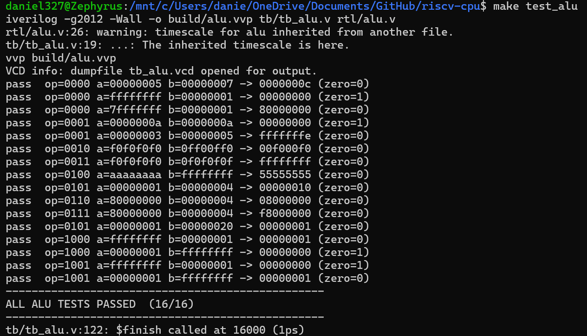
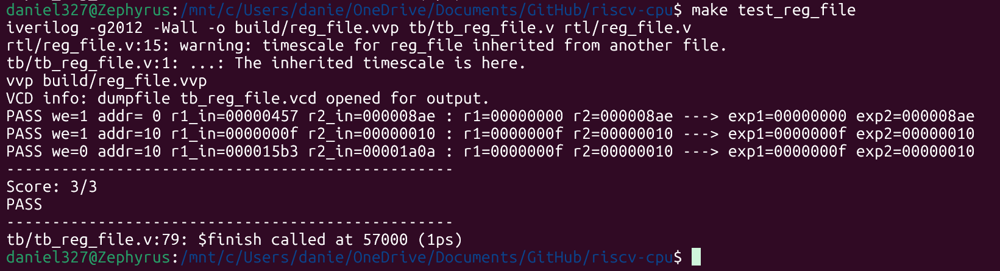
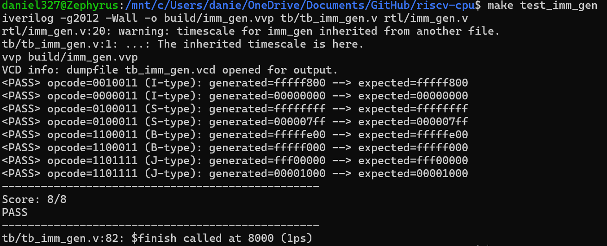
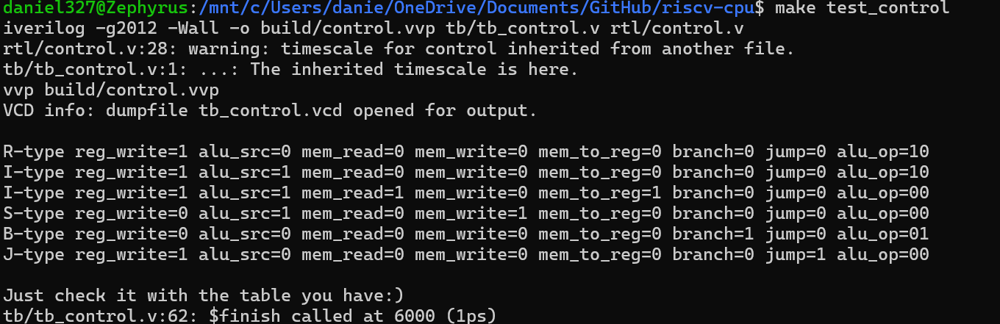
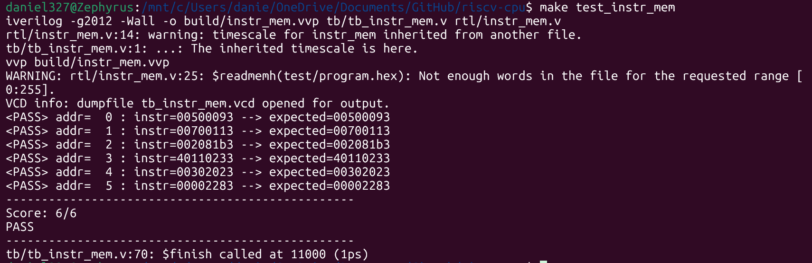
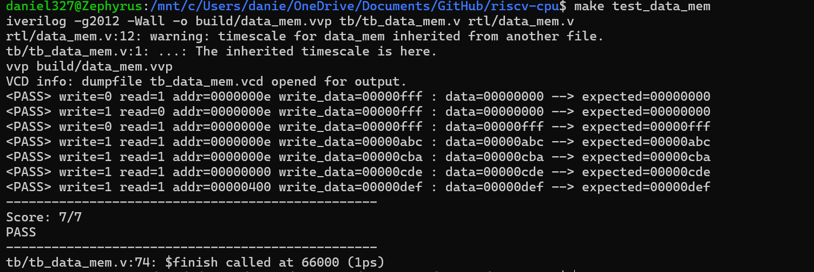

# Progress log

>  Day 1 - 2026-07-25 

## Done 
- Finished building the Arithmetic Logic Unit or ALU in short (`alu.v`). Tsted with a dedicated testbench file (`tb_alu.v`), all 16 test passed. Wrote combinational case for all 10 alu ops; learned signed shifts + b[4:0] slicing. 
- Learned about how to write a testbench, element such as time delay (#1), $display format, $random, etc. (`tb_alu.v`)
- Sidenote: spent like 1 hour fighting a nasty two copies of the repo bug (OneDrive vs Desktop).
- Completed register portion (`reg_file.v`), basic application of sequential circuit knowledge from digital circuit course, aka ECE124.

*ALU Passing*

## Doing 
- Working on testbench for register, (`tb_reg_file.v`), learning how to generate a periodic clock signal to test it since it contains synchronous logic. 

> Day 2 - 2026-07-26

## Done
- Finished building register file testbench (`tb_reg_file.v`)
- Learned how to build a testbench when synrchronous block is involved, such as time delay, how to generate a clock signal. Also, how to build a check function to check different cases, display results, use of system task and functions. The cases are not random, coming up cases that covers lots of scenarios, like what happen when your read address is 0 but enable is 1, in RISC-V, address 0 register always store the value 0, easier for doing arithmetic with 0.

*REG_FILE Passing*

## Doing
- Moving on to imm_gen (`imm_gen.v`)

> Day 3 - 2026-07-27

## Done
- Done building immediate generation file (`imm_gen.v`)
- Basically learned what does a instruction contains, and that the last 7 bits is reserved for op-code that tells the system what type of operations it is. For example I-type needs 2 source register address, 1 destination register address, a 12 bit immediate and a predetermined 7 bits op-code used conventionally for RISc-V.
- Also understood why the immediate is often scrambled in the instruction, because different operations requires different amount of source register address and maybe doesn't need a destination, writing into the memory instead. So the point of the immediate generation is to pull the scrambled immediate in an instruction and piece the numbers back together.
- Understood the logic behind the testbench for this module (`tb_imm_gen.v`), plan to use contactenation to work backwards for coming up with expected values to check, that way I don't have to disect a random 32 bits instruction every single time.

## Doing
- Working on testbench (`tb_imm_gen.v`), have the logic in mind but just need some time to implement it in Verilog.

> Day 4 - 2026-07-28

## Done
- Completed immediate generation testbench (`tb_imm_gen.v`), hardest part was really coming with expected value for tests. 
- Getting more familiar with the testbench format, and also better some of my understanding of the when to use wire and reg, as well as how strings are treated in Verilog, kind of annoying because Icarus doesn't really compile when you have a wide string as inputs for task, which is why it took me so long to get it to run.
- Just tested a few cases for each operation type, like the sign bit extending and basic un-scrambelling of the immediate from the instruction bits.
- Also understand why it's B-type and J-type has different immediate structure comparing other type like I and S. 

*IMM_GEN Passing*

## Doing
- Moving on to control unit (`control.v`), which reads the opcode and produce all datapath control signals from all the module I've built so far. 
- Before implementing that I will fill in the `control_signals.md` just to organize my thinking and wiring. 

> Day 5 - 2026-07-29

## Done
- Completed control signal table (`control_signal.md`).
- Understood function of different instruction type, and what component they require to work.

## Doing
- Will move on to control unit (`control.v`) next time I work on this. 

> Day 6 - 2026-07-30

## Done
- Using the filled in control signal table, implemented the decoding of 7 bit opcode for control module (`control.v`)
- It basically activates different signal for different operator, and alu_op has either force ADD / SUB and one for other ALU operations
- Build a simple displaying testbench for verifying the LUT (`tb_control.v`).

*CONTROL Passing*

## Doing
- Moving on to alu control, that decodes the coarse 2bit alu_op and function3, one of function7 bits, all into the 4 bits fine alu_op that I've designed in `alu.v`.

> Day 7 - 2026-07-31

## Done
- Completed alu control (`alu_control.v`), don't really need a testbench, just a simple LUT. 
- Learned about why there are unassigned bits in function7 which is part of the instruction ; they are for extensions or specific application the designer chose to implement.
- Finished instruction memory module (`instr_mem.v`) as well as testbench (`tb_instr_mem.v`).
- Understood the address structure, converting of bytes address into word index of mem array by disregarding the first 2 bits (equivalent of dividing by 4).
- Learned new system function `$readmemh` which reads lines of hex numbers in a file and put one and each of them in array slots.
- So for the testbench, I've used `program.hex` for the system task to read off, and see if the instructions result matches with the values I read from the memory array. 

*INSTR_MEM Passing*

## Doing
- Will move on to `data_mem.v`, should relatively similiar to `reg_file.v`.
- After that, routinely will build a testbench.

> Day 8 - 2026-08-01

## Done
- Finished data memory module (`data_mem.v`), implementing an memory array and read and write functions.
- Completed testbench for this module (`tb_data_mem.v`) as well as testing multiple cases.

*DATA_MEM Passing*

## Doing
- Moving on to CPU module (`cpu.v`) and wire all module I've implemented together.

> Day 9 - 2026-09-16

## Done
- Quite a gap from Day 8, that's because final exams and family trip took up most of my time. 
- Finished `cpu.v` stage one, aka the program instruction address handling.
- Displayed waveform to check pc behaviours when resetting. 

*Stage 1 cpu waveform with clk line, instruction, pc_out and reset pulse*

## Doing
- Moving on to stage 2 of `cpu.v`.

> Day 10 - 2026-10-12

## Done
- Another gap from previous day because my laptop was reparing
- Finished stage 2 and 3 of `cpu.v`, including immediate generation, register file, alu control / alu decode, and a control module drive signals such as jump, branch, register writing enable etc. 

*Stage 2 & 3 cpu waveform, showcasing all signals and arithmetic result.*

*I used this to compare the result from waveform, to verify arithmetic result and other signals.*

## Doing
- Moving on to stage 4, which is memory and write back for lw/sw operation.

> Day 11 - 2026-10-14

## Done
- Finished stage 4, using waveform I checked if lw/sw are working as intended, and you can see in the waveform that in the seocnd last instruciton, it loads (sw) 12 or `C` in hex into mem[0], and then in the last instruction it extracts (lw) from mem[0] which is evident in rd_data as being `C` in that clock cycle.
- Finished stage 5 which is pc handling when either branch or jump is used.

*Stage 4 cpu waveform, verifying lw/sw functionality. 

## Doing 
- Run regression check to see if everything is working correctly
- Write small program to check jump and branch functionality.

> Day 12 - 2026-10-17

## Done
- Old programs still runs
- Loaded a new program to check `beq` and `jal`, and checked waveform to ensure program counter jump is correct

*Stage 5 cpu waveform, ensureing rd_data and pc jumping matches with corresponding instruction.

## Doing
- Waiting for development board to arrive
- Perhaps move on to upgrade 

> Day 13 - 2026-10-20

## Done
- Created a top module `de10_top.v` for wiring physical input and output with all my v files.
- Synthesised my RTLs into newly bought DE-10 Lite development board with the MAX 10 FPGA chip.
- Implemented hex to 7seg module, clk divider module to step it down from 50MHz to around 1Hz to display on 7seg
- Wired a pusb button to reset, another one to shop the chopped top 2 bit of my 32 bit data because I only have 6 7seg display, configured a switch to switch between showing my pc counter or my register data of any address I input through 4 other switches.

## Doing
- Moving on to implementing other operations in my RTLs to fully complete the RISCVI instruction set

> Day 14 - 2026-10-25

## Done
- Completed all branch instruction, jalr, fixed issue with function7 distinction for R-type and I-type
- Set up risc-v gnu pipeline to automatically turn assembly code into hex for testing
- Verified output against assembly code

*Assembly code to put into the test pipeline*

*CPU testbench generated result, verified against assembly code

## Doing
- Moving on to sub-word loads and stores instruction to fully complete RV32I
- Plan to run a C program (not C++ because the processor dosen't have heap and OS) 

> Day 15 - 2026-10-26

## Done
- Successfully implemented all instructions for base integer instruction set.
- Verified against assembly code and register output.

## Doing
- Run a compiled C program

>> Day 16 - 2026-10-28

## Done
- Successfully ran a compiled C program through riscv-gnu toolchain
- verifed result against register value

## Doing
- Can try meatier C progrma, such as algorithm, recursions, etc.
- Deploy to DE-10 for monitor real time result
- Pipeline or M-extensions or 

>> Day 17 - 2026-11-01

## Done
- Deployed newer version to DE-10 and captured flow and timing result

*Flow summary*

*Timing analyzes*

## Doing
- Same as last time

>> Day 18 - 2026-11-04

## Done
- Updated few moduels to SV, learned about enum, structs, import package, etc.

## Doing
- Continue to convert all modules into SV before pipelining.

>> Day 19 - 2026-11-05

## Done
- Successfully migrated my single cycle RV32I from verilog to SV.
- Compiled and ran the C program, got the same result in the end, refer to Day 14 testbench result.

## Doing
- Moving on to actually pipelining the RV32I.

>> Day 20 - 2026-11-07

## Done 
- Finished IF, ID, EX, MEM stages and all pipeline reg in between.
- Implemented forwarding units to prevent register read hazard.

## Doing
- Moving on to MEM to WB pipeline reg and then WB stage.
- Need to implement No-op for loading instruction to prevent hazard.
- Update reg unit's we, rd addr and data once finished with WB stage.
- Implement branch prediction to reduce stalling from ID and IF pipeline reg flushing.
- Synchronize mem_read so that I can use the BRAM in the DE-10 board when synthesizing.

>> Day 21 - 2026-11-08

## Done
- Completed all stages and pipeline registers
- Forwarding units now handles all 3 cases, ex_mem, mem_wb and wb to reg.
- Completed Load use stall
- Completed branch and jump flushing.
- Verified against expected values, the same `prog_hex` as before (C programs return 55). 
- Implemented simple valid bit and return instruction counter to calculate CPI for metrics comparison with single cycle version RV32I.
- Updated README.

*CPI result shown from tb*

## Doing
- Implement branch prediction to reduce stalling from ID and IF pipeline reg flushing.
- Synchronize mem_read so that I can use the BRAM in the DE-10 board when synthesizing.

> Day 22 - 2026-11-09

## Done
- Learning about branch prediction logic and mechanism.

## Doing
- Continue branch prediction unit next time.

> Day 23 - 2026-11-10

## Done 
- Complete branch prediction unit, verified against the C program.
- Get new metrics, such as CPI and Fmax if any changes
- Install Verilator for better compilation for SV.
- Removed Icarus workaround in `cpu.sv`.
- Synthesized new versions.
- Discovered Fmax was significantly worse, dropping from 64 MHz to 50MHz since last time.
- Used Timing analyzer in Quartus Prime to see path summar.

*CPI improving from 1.42 to 1.30 after implementing branch prediction*

*Likely fabric congestion of branch prediction large LUT mux.

## Doing
- Need to improve Fmax, will see if moving those but LUT mux to BRAM wil help or not.

> Day 24 - 2026-11-11

## Done
- Synchronized the data memory read so Quartus infers **M9K block RAM** for the array (byte-lane template — four byte-wide arrays, per-lane write enables, registered read). This moved ~8,100 flip-flops out of the fabric; logic usage roughly halved (18k -> 8k LEs).
- Spent most of the day chasing why Fmax *wasn't* improving. Turned out it was never really congestion — it was a stack of critical paths, each fix just exposing the next one underneath. Used the Quartus Timing Analyzer at every step instead of guessing (guessed wrong a few times, the report was right every time).
- Found the register file was being inferred into M9K with "write-first bypass" glue around it. The real fix was switching the reg file to **negedge write**, which removes the combinational WB->read bypass that was the top critical path.
- Reduced the branch-predictor critical path with **direction-based mispredict detection**: precompute `(predicted != pc+imm)` and `(predicted != pc+4)` from registered values, then let the 1-bit `branch_taken` select between them — instead of a 32-bit compare of `actual_next_pc` vs `predicted` sitting on the PC loop. `jalr` just always-flushes (its target is late and it's rare).
- Net result: **Fmax recovered 44 -> 51.72 MHz**, CPI steady at 1.30, data memory now in BRAM.
- Honest finding: the predictor is still a net *throughput* tradeoff on this core (~45 -> ~40 MIPS) because branches resolve in EX, so the branch-resolution path is the clock limiter. Full investigation written up in `docs/devlog.md`.

*Data memory inferred into M9K — logic elements and registers roughly halved.*

*After the direction-based mispredict fix: Fmax back up to 51.72 MHz.*

## Doing
- Realize the predictor's benefit: move to **early branch resolution** (resolve in ID) or a deeper fetch pipeline, so adding the predictor doesn't cost Fmax.
- **Return-address stack** for `jalr` (predict returns instead of always-flushing).
- Official `riscv-tests` compliance suite; instruction/data caches.